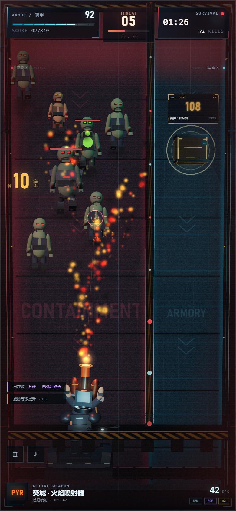

# DEAD//SPLIT · 尸潮分界



一款竖屏、双线分屏的 3D 生存射击小游戏。左侧是加宽的感染者主战区，右侧是变窄的军需补给通道。机枪手会自动索敌、持续开火，你只需要左右滑行：滑到怪物下方倾泻火力，或冒险进入军需区打光补给箱上的数字。

## 运行

### 方式一：双击打开（推荐）

直接双击 `index.html`。游戏已经打包为单文件 `game.js`，不依赖网络和服务器。

> 如果浏览器对本地文件限制较严，使用方式二。

### 方式二：本地服务器

```bash
npm install
npm start
```

打开终端输出的地址（默认 <http://127.0.0.1:4173>）。

Windows 也可以双击 `play.cmd`，会自动启动本地服务器并打开浏览器。

## 操作

- **A / D 或 ← / →**：控制机枪手左右滑行。
- **鼠标左右拖动 / 触屏左右拖动**：同样可以控制滑行。
- **自动索敌与开火**：无需瞄准或点击，枪口会自动锁定横向范围内最近的目标并射击。
- **P / Esc**：暂停。
- **M**：静音。
- 左下角 `Ⅱ` 暂停，`♪` 静音。

## 核心机制

- **左线 · 感染区（加宽）**：行尸、疾行者、装甲感染者、喷吐者，以及周期性出现的「暴君」会从上往下推进。穿过防线会持续啃噬装甲。
- **右线 · 军需区（收窄）**：补给箱上带有一个巨大的数字，也就是它的耐久。滑到补给箱下方，把数字打光即可夺取奖励；进入军需区时，枪口会优先锁定补给箱。
- **走位与闪避**：喷吐者和暴君的酸液会朝你开火时的位置落下，横向移动可以躲开；但离开感染区也意味着怪物更接近防线。
- **威胁等级**：击杀越多，威胁等级越高，敌人生命、速度和数量都会上升，并逐渐解锁更危险的种类。每 3 个关键等级会出现 Boss。
- **武器库**：V-07 复仇者机枪、焚城火焰喷射器、万伏电弧冲锋枪、雷神磁轨炮、湮灭等离子炮。每把武器都有独立的弹道、特效和攻击逻辑。
- **模块升级**：伤害、射速、双联弹丸、穿甲、暴击、爆裂弹头、冷凝减速、哨戒无人机、纳米修复、反应装甲、壁垒回血、脉冲冲击波。
- **连杀**：短时间连续击杀会提高得分倍率。
- **最高记录**：自动保存在浏览器本地。

## 技术

- 纯 HTML / CSS / JavaScript，无后端。
- [three.js](https://threejs.org/) 0.180 负责全部 3D 场景、模型、粒子、光照和镜头。
- 程序化 Web Audio 音效与背景音乐，无外部音频资源。
- 竖屏优先的响应式布局，支持键盘、鼠标拖动、触屏拖动、桌面和移动端。
- 粒子、弹道、光束、电弧、冲击波均为对象池或 GPU 点渲染。

## 开发

```bash
npm install
npm run build   # 将 src/ 打包为单文件 game.js
npm start       # 本地预览
```

源码位于 `src/`：

- `game.js`：游戏循环、敌人/补给/升级系统、输入与 UI
- `environment.js`：双线场景与工业风环境
- `models.js`：机枪手、感染者、补给箱、无人机模型
- `effects.js`：曳光弹、光束、电弧、冲击波对象池
- `particles.js`：GPU 点粒子系统
- `audio.js`：程序化音效与音乐
- `data.js`：武器、升级、敌人配置

## 第三方

three.js — MIT License, Copyright © 2010-2025 three.js authors.
